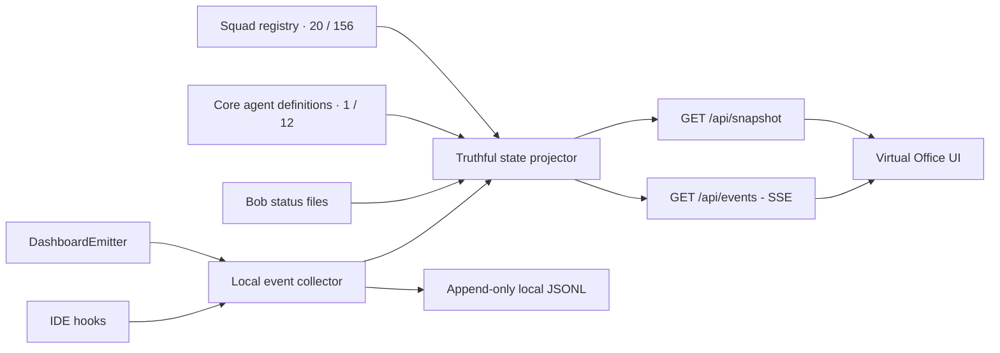

# Architecture — AEXOS Virtual Office

**Story:** [AEX-3.6](./STORY-AEX-3.6-VIRTUAL-OFFICE.md)  
**ADR:** [ADR-AEX-009](./adr/ADR-AEX-009-VIRTUAL-OFFICE-PROJECTION.md)  
**Version:** 1.1  
**Date:** 2026-08-16  
**Status:** Implemented; certified-ground and high-zoom remediation in review

## Purpose

Deliver a premium, project-local virtual office that visualizes observed AEXOS
agent execution without becoming an execution or decision surface. The office
uses the registered squad catalog for identity and consumes runtime telemetry for
activity. It never calls an AI API and never fabricates work when telemetry is
absent.

## Requirements and evidence

- The user approved a read-only local dashboard after the repository assessment
  and requested a premium, more futuristic version of an isometric office layout.
- Every rendered agent must wear a jacket carrying the exact Cyryx Labs logo
  supplied by the user. The logo is an input asset, not a generated substitute.
- The visual reference contributes spatial composition only: top-down isometric
  work islands, desks, screens and seated workers. Overlay copy and social-video
  controls in the reference are not product requirements.
- Constitution Article I requires CLI-first operation and a dashboard that only
  observes. [Source: `.aexos-core/constitution.md`, Article I]
- The roadmap already defines AEX-3.6 as a read-only SSE cockpit.
  [Source: `docs/framework/epics/aexos-evolution/ROADMAP.md`, AEX-3.6]

## Scope

### In scope

- `aexos office` and `aexos-office` local CLI entrypoints.
- Local HTTP event collector bound to loopback by default.
- Project snapshot and Server-Sent Events stream.
- Projection of the squad registry plus observed runtime events into truthful
  agent states.
- Premium responsive virtual office with a furnished image-backed 2.5D campus,
  independently rendered agent presences and observed waypoint routing.
- Exact Cyryx Labs logo displayed as the jacket crest.
- Keyboard navigation, readable status labels, reduced-motion behavior and a
  non-spatial list view for narrow screens and assistive technology.

### Out of scope

- Starting, stopping, prompting or approving agents from the dashboard.
- Displaying private chain-of-thought or hidden model reasoning.
- Calling an AI API from the dashboard.
- Inventing activity, demo agents or sample health data in live mode.
- A cloud service, authentication platform or multi-user remote deployment.
- Unique photorealistic portrait generation for every individual agent.

## Current-state map

| Existing component | Reused capability | Current gap |
|---|---|---|
| `core/events/dashboard-emitter.js` | Local HTTP event POST and JSONL fallback | No receiver is shipped |
| `core/events/types.js` | High-level lifecycle event names | No authoritative state projection |
| `core/orchestration/dashboard-integration.js` | Orchestrator lifecycle binding | Status is fragmented across files |
| `core/orchestration/bob-status-writer.js` | Agent, task, phase and terminal/PID snapshot | Bob-specific schema |
| `core/execution/parallel-monitor.js` | Parallel task status and WebSocket-shaped broadcast API | No server and no production consumer |
| `data/squad-registry.yaml` | 20 squads and 156 squad agents | Catalog is not runtime activity |
| `development/agents/*.md` | 12 canonical core agents that emit framework lifecycle events | Not represented in the squad registry |
| `scripts/diagnostics/health-dashboard` | Existing visual/dashboard patterns | Health-focused and permits sample fallback |
| `core/graph-dashboard` | Local CLI/browser opening patterns | Visualizes code dependencies, not agents |

## Options considered

### Option A — React + WebGL/Three.js application

- **Advantages:** full geometric 3D, camera movement, mature scene tooling.
- **Trade-offs:** new runtime/build dependencies, larger published package,
  slower first paint for 156 agents and a harder accessible fallback.

### Option B — Local SSE server + deterministic DOM/image-backed 2.5D

- **Advantages:** no new runtime dependency, ships inside the existing package,
  accessible semantic DOM, high-fidelity furnished imagery, fast startup and
  exact logo compositing.
- **Trade-offs:** fixed-camera 2.5D rather than free-camera geometry.

### Option C — Electron desktop application

- **Advantages:** native window, filesystem bridge and richer OS integration.
- **Trade-offs:** separate distribution lifecycle, larger attack surface and
  unnecessary coupling for an observability-only capability.

### Decision

Use **Option B** for the first vertical slice. It satisfies the reference's
isometric office composition while preserving CLI-first portability and package
simplicity. The event/state boundary remains renderer-agnostic so a future WebGL
renderer can consume the same snapshot without changing the collector.

## System architecture



The UI has no mutation endpoint. `POST /events` is an ingestion boundary for
runtime telemetry, not a dashboard control.

## Components

### Configuration loader

- Loads immutable defaults from `virtual-office.config.yaml`.
- Permits CLI overrides for host, port, browser opening and project root.
- Rejects non-loopback binding unless a future explicit security story adds it.

### Registry loader

- Reads `.aexos-core/data/squad-registry.yaml` from the selected project.
- Falls back to the framework copy only when the project is a valid installed
  AEXOS project and its local registry is absent.
- Reads the 12 canonical `.aexos-core/development/agents/*.md` definitions as a
  separate `AEXOS Core` pod so framework events such as `@dev`, `@qa` and
  `@architect` resolve to their real identities instead of false squad aliases.
- Produces stable `squad_id` and `agent_id` catalog records.

### State projector

- Creates all registered agents as `available`, never `working`.
- Applies normalized observed events to a finite state machine.
- Tracks `session_id`, `run_id`, task, story, phase, PID and last observed time
  when supplied by the producer.
- Projects `AgentCollaborationMessage` only from the explicit `public_message`
  field; generic message, prompt and tool-output fields cannot enter the meeting
  transcript contract.
- Uses heartbeat/TTL expiry to move abandoned active states to `stale`.
- Maintains a bounded, redacted event timeline.

### Local collector/server

- Uses Node's built-in `http` module; no external service is required.
- Serves immutable UI assets and JSON/SSE endpoints.
- Accepts the existing dashboard and monitor-hook event envelopes.
- Appends accepted normalized events to `.aexos/dashboard/office-events.jsonl`.
- Tails the legacy `.aexos/dashboard/events.jsonl` fallback on startup so events
  emitted while the server was offline are replayed.

### Virtual Office renderer

- Task 16 replaces the raster-only spatial model with the layered scene graph
  in [ADR-AEX-010](./adr/ADR-AEX-010-LAYERED-SCENE-GRAPH.md). The packaged,
  people-free Cyryx campus remains the furnished environmental art, but a
  versioned manifest is now authoritative for dimensions, navigation,
  workstations, meeting seats, reception bounds, depth and screen surfaces.
- Semantic DOM layers remain authoritative for accessible squads, agents and
  interactions. A full-world Canvas 2D presentation layer may animate
  registered monitor surfaces, but those ambient visuals never represent agent
  state or create telemetry.
- The campus includes a luxury reception zone with a large architectural Cyryx
  panel composed from the exact packaged mark and clean wordmark assets. The
  panel is the visible Reception focus control; the focused composition keeps
  it prominent and exposes AEXOS Master's adjacent registered work chair. The
  view changes only camera/filter selection, never runtime authority.
- Renders 20 squad pods plus the AEXOS Core pod: 21 pods and 168 agents in the
  current baseline, with filtering and focus.
- Four transparent Cyryx-jacket identity atlases expose 24 adults, each with a
  stable row and three coherent poses: left-walk, right-walk and seated work.
  The visible floor cohort preserves the assigned identity across pose changes
  and resolves simultaneous slot collisions without changing telemetry.
- Each avatar includes a jacket crest that references the exact project asset.
- The campus overview selects one available representative per squad; selecting
  a squad materializes its complete matching roster. The visibility cohort is
  therefore independent from the movement budget and remains bounded by 21
  certified workstations plus the AEXOS Master reception desk.
- At most four available agents walk on image-registered `floorNode` segments
  with globally reserved destinations. All other visible available agents use
  seated presentation at unique assigned desks. Walkers keep a reserved desk
  and the walking set rotates back to those desks every two minutes. This visual
  presence treatment cannot promote state or create an activity event.
- Projected active states stop ambient circulation and route agents back to
  their reserved workstation while selecting the seated frame of the same
  identity. Agents sharing an observed story, run or session retain that desk
  reservation while occupying up to eight certified meeting-room seats before
  deterministic overflow to project
  anchors. A live beacon and accessible tabbed window expose participants and
  the complete bounded stream of explicit public collaboration messages.
- A calibrated bottom-of-foot anchor, perspective scale, contact shadow,
  image-registered chair anchors, signal bays, certified short-route arrivals
  and hidden relocation between disconnected zones prevent floating, tabletop
  traversal and squad-anchor piles. Seat validity is geometric: coordinate
  uniqueness alone is not accepted as proof of furniture registration.
- Route receipts remain on the agent DOM presence for runtime verification.
- The inspector keeps observed work, operational state and presentation posture
  in separate fields so visual animation cannot masquerade as task telemetry.
- The 2.5D camera supports 90–260% zoom, bounded pointer/touch panning, wheel
  zoom, keyboard panning and deterministic squad focus. Its reset frame uses a
  1672:941 aspect-ratio-safe cover strategy: the camera is always filled, while
  bounded panning retains access to any edge cropped by the viewport shape.

## State model

```yaml
agent_state:
  available: registered but no observed run
  assigned: observed assignment without process start
  running: observed command, tool or spawned process
  waiting: observed wait or pending external input
  blocked: observed blocked/error requiring intervention
  completed: observed successful completion within the recent-event window
  failed: observed failed completion within the recent-event window
  stale: active state whose heartbeat lease expired
  offline: catalog/runtime adapter unavailable when that distinction is known
```

Transitions require a timestamped event. Timed visual decoration may decay from
`completed` or `failed` back to `available`, but no timer may promote an agent
to an active state.

## Local API contract

| Method | Path | Purpose |
|---|---|---|
| `GET` | `/health` | Collector readiness and project binding |
| `GET` | `/api/snapshot` | Project, counts, squads, agents and recent events |
| `GET` | `/api/events` | Read-only SSE stream with snapshot + deltas |
| `POST` | `/events` | Runtime telemetry ingestion; accepts existing envelope |
| `GET` | `/assets/*` | Packaged visual assets |

Unknown routes return JSON `404` for API paths and do not expose filesystem
paths. Request bodies are bounded. Only allowlisted event metadata reaches the
browser; raw prompts, environment variables and unbounded tool output do not.
The meeting transcript consumes only sanitized `public_message` content from
`AgentCollaborationMessage`; no lifecycle event is paraphrased into dialogue.

## Configuration

```yaml
virtual_office:
  host: 127.0.0.1
  port: 4001
  open_browser: true
  heartbeat_ttl_ms: 30000
  recent_completion_ms: 12000
  event_history_limit: 200
  max_event_bytes: 65536
  polling_interval_ms: 1000
  brand:
    logo_asset: public/assets/cyryx-labs-logo.png
```

CLI flags override the YAML without modifying it. The server will fail clearly
when the configured port is unavailable; it will not silently select a random
port because existing emitters target port 4001 by default.

## Security and privacy

- Bind to `127.0.0.1` only.
- Dashboard is read-only; no workflow action endpoints.
- Project root is resolved once and every served path remains under the static
  asset root.
- Payload size, content type and event types are validated.
- Timeline fields are allowlisted and truncated; secrets and raw environment
  payloads are never rendered.
- Responses use CSP, `nosniff`, no-store API caching and restrictive CORS.

## Performance and accessibility

- Snapshot supports the current 168 agents/21 pods without pagination.
- Target event-to-visual latency: below one second on localhost.
- Only changed agent state is projected after SSE deltas; a maximum four-person
  ambient cohort uses CSS position transitions plus paired gait animation
  without a WebGL or animation runtime dependency.
- `prefers-reduced-motion` disables ambient and status animations.
- Every agent is a keyboard-focusable button with name, squad and textual
  status; color is supplementary.
- Mobile/narrow view switches to a readable squad roster while preserving the
  same data and detail panel.

## Test strategy

- **Unit:** configuration, registry parsing, event normalization, state
  transitions, TTL and redaction.
- **Integration:** HTTP health/snapshot, POST ingestion, SSE delivery, static
  traversal rejection and graceful shutdown.
- **CLI:** argument parsing, help, JSON readiness and root command routing.
- **UI contract:** all required landmarks, accessible controls, logo reference,
  reduced-motion CSS and absence of sample/fake activity.
- **Regression:** root lint, typecheck, Jest suite and publish validation.

## Risks and mitigations

| Risk | Severity | Mitigation |
|---|---|---|
| Ghost agents remain active | High | Heartbeat lease, explicit stale state, no inferred promotion |
| Tool output exposes secrets | High | Allowlist metadata, truncate, never render raw environment/prompt |
| 168 avatar presences overload the page | Medium | Shared raster atlas, state-driven motion, reduced-motion, focused rendering |
| Logo becomes illegible on small avatars | Medium | Use exact asset in a clipped crest plus full brand mark in header |
| Port conflict breaks telemetry | Medium | Stable documented port, actionable startup error, CLI override |
| UI drifts into a control plane | High | No action endpoints; Article I tests and documentation |

## Validation and approval

- **Architect:** prior repository assessment selected local event projection and
  read-only visualization; this document formalizes that decision.
- **Product alignment:** AEX-3.6 exists in the approved epic roadmap.
- **User:** explicitly approved implementation and supplied the visual and brand
  direction on 2026-08-16.
- **UX:** packaged premium campus imagery plus deterministic branded agent
  presences selected over CSS-art avatars and generated logo imitations.
