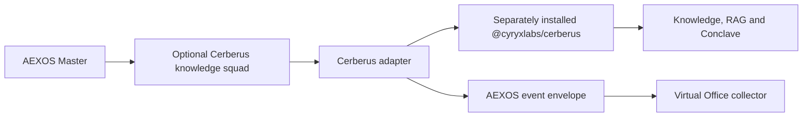

# Cerberus / Cyryx MegaBrain — AEXOS Integration Assessment

## Verdict

Keep Cerberus as a **separately versioned companion product** and integrate it
with AEXOS through an optional, narrow adapter. Do not copy the complete
Cerberus repository into `.aexos-core` and do not make it the AEXOS routing
authority.

## Evidence inspected

- `package.json` publishes `@cyryxlabs/cerberus` as an ESM Node CLI backed by a
  Python engine and project-local `.claude` footprint.
- `bin/cerberus.js` exposes subprocess, future MCP and future API dispatch modes,
  plus knowledge search, ingestion, indexing, dossier and Conclave commands.
- `squads/orquestrador-global/squad.yaml` declares its own central router,
  registry, team execution and squad-creation authority.
- `engine/jarvis/docs/architecture/*` describes a Claude Code and external API
  oriented knowledge system rather than an AEXOS-native runtime component.
- Current RAG modules select OpenAI embeddings and answer synthesis when those
  operations are used; therefore Cerberus as a whole cannot satisfy the Virtual
  Office's no-external-AI dependency boundary.

## Blocking findings for direct embedding

1. **Authority collision:** Cerberus' `orquestrador-global` overlaps AEXOS
   Master's routing and squad-creation authority.
2. **Installation collision:** both products own root `.claude` projections,
   commands, hooks and skills. Blind copying would overwrite or drift project
   configuration.
3. **Runtime split:** Cerberus is ESM plus Python; AEXOS core and the Virtual
   Office are CommonJS/Node and dependency-light. Merging would couple two
   release and dependency lifecycles.
4. **Incomplete dispatch seam:** `bin/cerberus.js` imports
   `engine.operations`, but `engine/operations.py` is absent in the inspected
   checkout. Operational CLI shortcuts cannot be treated as an integration
   contract until that seam exists and is tested.
5. **Metadata drift:** the package is `UNLICENSED`, while the global squad file
   declares `MIT` and `author: your-org`; older architecture files retain
   legacy MegaBrain environment names and a sales-only system context.
6. **Dirty source checkout:** the inspected repository contains user changes.
   This assessment made no modification to it.

## Recommended boundary

### Adapter responsibilities

- Discover an explicitly configured Cerberus installation; never silently copy
  or bootstrap it.
- Expose a small capability set such as `search`, `ingest`, `index`, `dossier`
  and `conclave` after the missing operation-dispatch seam is repaired.
- Translate lifecycle receipts to the existing AEXOS event envelope with
  `agent_id`, `squad_id`, `story_id` or `run_id`, state and timestamps.
- Emit collaboration text only when Cerberus explicitly marks it public. Raw
  prompts, retrieved private context, credentials and provider output remain
  outside the Virtual Office transcript.
- Keep provider keys and knowledge data owned by Cerberus. AEXOS stores only
  adapter configuration and redacted observability receipts.

## Integration sequence

1. Repair and test the Cerberus `engine.operations` dispatch contract.
2. Resolve metadata, legacy naming and router-authority conflicts in Cerberus.
3. Define a versioned adapter JSON contract and threat model in a separate AEXOS
   story.
4. Ship the adapter as opt-in project configuration; keep normal AEXOS installs
   functional without Cerberus, Python or any AI provider key.
5. Add Virtual Office projection tests using captured adapter fixtures before
   enabling live integration.

## Decision boundary

Cerberus is a strong candidate for AEXOS' optional knowledge and deliberation
plane. It is not a replacement for AEXOS orchestration, not part of the Virtual
Office renderer and not ready to be merged directly into AEXOS core in the
inspected state.
